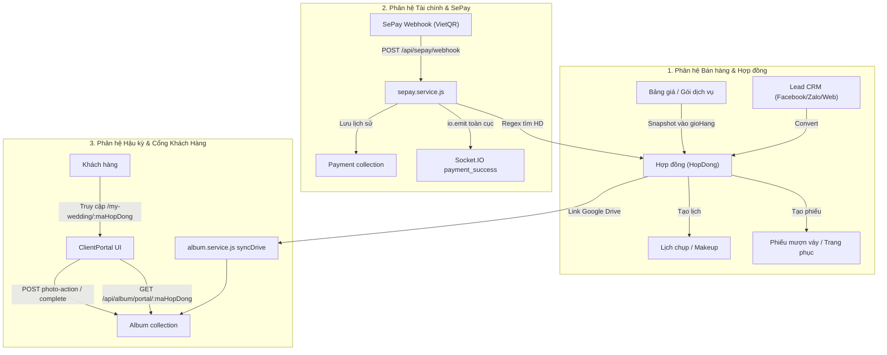

# LONG WEDDING v2.0 — TÀI LIỆU HIỆN TRẠNG HỆ THỐNG (CURRENT STATE)

**Mã tài liệu:** `docs/v2/01-current-state.md`  
**Phiên bản:** 1.0 | **Ngày lập:** 03/11/2026 | **Tác giả:** Antigravity  
**Trạng thái:** Đã xác minh qua mã nguồn thực tế (Code-Verified)

---

## 1. THÔNG TIN REPOSITORY VÀ PHIÊN BẢN (BASELINE COMMITS)

| Phân hệ | Đường dẫn thư mục | Git Branch | Commit SHA | Remote URL |
|---|---|---|---|---|
| **Frontend** | `D:\LONG WEDDING\HETHONG CNTT\quantri-longwedding` | `dev1.0` | `61ef333` | `https://github.com/maitienlong/quanly-longwedding.git` |
| **Backend** | `D:\LONG WEDDING\HETHONG CNTT\backend-quantri-longwedding\backend-admin-longwedding` | `dev` | `125cee9` | `https://github.com/maitienlong/quantri-longwedding-backend.git` |

---

## 2. CÂY CẤU TRÚC MODULE & KIẾN TRÚC HIỆN TẠI

### 2.1. Cấu trúc Backend (`backend-admin-longwedding`)
```text
backend-admin-longwedding/
├── package.json               # Node.js dependencies, main: src/server.js
├── .env                       # [LƯU Ý P0: Đang bị theo dõi bởi Git]
├── src/
│   ├── server.js              # Khởi tạo HTTP server & socket.io trên port 5000
│   ├── index.js               # Khởi tạo Express app, middleware (Helmet, RateLimit, MongoSanitize, CORS)
│   ├── socket.js              # Socket.IO instance, broadcast event "payment_success"
│   ├── config/
│   │   └── db.js              # Kết nối MongoDB qua mongoose (process.env.DATABASE_URL)
│   ├── middleware/
│   │   ├── auth.middleware.js # Kiểm tra JWT Bearer token & truy vấn User DB
│   │   ├── role.middleware.js # RBAC middleware kiểm tra chức vụ (Quản lý / Admin / along)
│   │   └── upload.middleware.js # Multer cấu hình upload file ảnh / audio
│   ├── models/                # 22 Mongoose Models
│   │   ├── user.model.js
│   │   ├── hopDong.model.js
│   │   ├── khachHang.model.js
│   │   ├── dichVu.model.js
│   │   ├── chiTieu.model.js
│   │   ├── lichSoanDo.model.js
│   │   ├── loaiHopDong.model.js
│   │   ├── loaiDichVu.model.js
│   │   ├── donViNhanTien.model.js
│   │   ├── storeTarget.model.js
│   │   ├── sepayConfig.model.js # [LƯU Ý P0: Hardcode default secretKey & STK]
│   │   ├── payment.model.js
│   │   ├── thiepCuoi.model.js
│   │   ├── album.model.js
│   │   ├── log.model.js
│   │   ├── blockedIp.model.js
│   │   ├── visitorLog.model.js
│   │   ├── voucher.model.js
│   │   ├── trangPhuc.model.js
│   │   ├── thueDo.model.js
│   │   ├── lead.model.js
│   │   └── kichThuocAnh.model.js
│   ├── routes/                # 20 Express Routers
│   │   ├── auth.router.js
│   │   ├── khachHang.router.js
│   │   ├── dichVu.router.js
│   │   ├── hopDong.router.js
│   │   ├── chiTieu.router.js
│   │   ├── lichSoanDo.router.js
│   │   ├── website.router.js
│   │   ├── thiepCuoi.router.js
│   │   ├── album.router.js
│   │   ├── log.router.js
│   │   ├── visitors.router.js
│   │   ├── loaiHopDong.router.js
│   │   ├── loaiDichVu.router.js
│   │   ├── thidua.router.js
│   │   ├── sepay.router.js
│   │   ├── baoCao.router.js
│   │   ├── donViNhanTien.router.js
│   │   ├── voucher.router.js
│   │   ├── trangPhuc.router.js
│   │   └── lead.router.js
│   ├── services/              # Business Logic tương ứng 20 routes
│   └── utils/
│       ├── response.js        # Helper format success/error response
│       ├── logger.js          # Helper tạo Audit Log vào collection `logs`
│       ├── dateUtils.js       # Format ngày tháng ICT
│       └── legacyPackageAdapter.js
```

### 2.2. Cấu trúc Frontend (`quantri-longwedding`)
```text
quantri-longwedding/
├── package.json               # React 18.3.1, React-Router-DOM v7.1.4, MUI v6
├── .env                       # [LƯU Ý P0: Đang bị theo dõi bởi Git]
├── src/
│   ├── index.js               # Entry point
│   ├── App.js                 # Router cấp cao: /login, /my-wedding/:maHopDong, /* (MainV2)
│   ├── API/
│   │   ├── axiosClient.js     # Axios instance, auto gắn Bearer token, handle 401/403 refreshToken
│   │   ├── endpoints.js       # Từ điển URL API tập trung
│   │   ├── socketClient.js    # Socket.IO client kết nối Backend
│   │   └── services/
│   │       ├── authService.js
│   │       ├── otherService.js # Service API chính chứa hơn 60 method gọi BE
│   │       ├── userService.js
│   │       └── websiteService.js
│   ├── UI/
│   │   ├── MainV2.js          # Shell giao diện trung tâm, Sidebar, Topbar, Navigation Router
│   │   └── css/
│   ├── screens/
│   │   ├── Login/             # Đăng nhập & AuthContext
│   │   ├── ClientPortal/      # Cổng khách hàng duyệt ảnh & thanh toán (/my-wedding/:maHopDong)
│   │   ├── TongQuan/          # Dashboard tổng quan
│   │   ├── HopDong/           # Lập hợp đồng & quản lý thanh toán, in ấn
│   │   ├── LichCuaHang/       # Lịch chụp, makeup, trả ảnh
│   │   ├── LichSoanDo/        # Lịch soạn đồ, mượn trả váy cưới
│   │   ├── QuanLyKho/         # Bảng giá dịch vụ & Kho váy vest
│   │   ├── QuanLyKhachHang/   # CRM khách hàng & Lead tư vấn
│   │   ├── QuanLyWebsite/     # CMS Website & Thiệp cưới online
│   │   ├── QuanLyVoucher/     # Quản lý mã giảm giá
│   │   ├── QuanLyChiTieu/     # Sổ thu chi nội bộ
│   │   ├── DoanhThu/          # Báo cáo doanh thu & công nợ
│   │   ├── ThiDua/            # Vinh danh & KPI nhân sự
│   │   ├── QuanLyNhanVien/    # Nhân sự & phân quyền chức năng
│   │   ├── SystemLogs/        # Nhật ký hệ thống
│   │   └── CauHinh/           # Cấu hình studio & mẫu in
│   └── utils/
│       ├── permissionHelper.js # Ma trận phân quyền chức năng FE
│       ├── salaryHelper.js     # Tính lương & hoa hồng nhân sự
│       ├── pinAuthUtils.js     # Khóa màn hình PIN
│       └── authUtils.js
```

---

## 3. CÁC LUỒNG DỮ LIỆU CỐT LÕI (DATA FLOWS)



---

## 4. DANH MỤC API BACKEND & PERMISSION MAPPING

Dưới đây là kết quả rà soát chi tiết tất cả 20 router mounted trong `src/index.js` của Backend:

### 4.1. Router `/auth` (`src/routes/auth.router.js`)
| Method | Path thực tế | Middleware Chain | Handler | Collection | Ghi chú & Rủi ro |
|---|---|---|---|---|---|
| `POST` | `/auth/createUser` | `authMiddleware`, `checkRole(["Quản lý"])` | `user.service.createUser` | `User` | An toàn |
| `POST` | `/auth/updateUser` | `authMiddleware` | `user.service.updateUser` | `User` | Cho phép self-update; Quản lý/along update người khác |
| `POST` | `/auth/updateUserPermissions` | `authMiddleware`, `checkRole(["Quản lý"])` | `user.service.updateUserPermissions` | `User` | An toàn |
| `POST` | `/auth/removeUser` | `authMiddleware`, `checkRole(["Quản lý"])` | `user.service.removeUser` | `User` | An toàn |
| `POST` | `/auth/findUsers` | `authMiddleware` | `user.service.findUsers` | `User` | Mọi user đăng nhập đều xem được danh sách nhân sự |
| `POST` | `/auth/loginUser` | *None* | `user.service.loginUser` | `User` | **P0:** Token hạn 36500 ngày (100 năm) |
| `POST` | `/auth/refreshToken` | *None* | `user.service.refreshToken` | `User` | **P0:** Nhận token hết hạn (`ignoreExpiration: true`), không revoke |

### 4.2. Router `/hopDong` (`src/routes/hopDong.router.js`)
| Method | Path thực tế | Middleware Chain | Handler | Collection | Ghi chú & Rủi ro |
|---|---|---|---|---|---|
| `POST` | `/hopDong/create` | `authMiddleware` | `hopDong.service.create` | `HopDong` | Bất kỳ staff nào cũng tạo được |
| `POST` | `/hopDong/update` | `authMiddleware` | `hopDong.service.update` | `HopDong` | **P0:** Cho phép sửa thanh toán, giảm giá mà không checkRole Quản lý |
| `POST` | `/hopDong/pay` | `authMiddleware` | `hopDong.service.pay` | `HopDong` | Dead code: Find all contracts và không res.json |
| `POST` | `/hopDong/remove` | `authMiddleware`, `checkRole(["Quản lý"])` | `hopDong.service.remove` | `HopDong` | Có chặn nếu đã có thanh toán |
| `POST` | `/hopDong/update-progress` | `authMiddleware` | `hopDong.service.updateProgress` | `HopDong` | Chuyển giai đoạn |
| `POST` | `/hopDong/list` | `authMiddleware` | `hopDong.service.list` | `HopDong` | Lấy danh sách hợp đồng |
| `POST` | `/hopDong/search` | `authMiddleware` | `hopDong.service.search` | `HopDong` | Tìm kiếm hợp đồng |
| `POST` | `/hopDong/update-post-production` | `authMiddleware` | `hopDong.service.updatePostProduction` | `HopDong` | Cập nhật tiến độ hậu kỳ |
| `POST` | `/hopDong/add-addon` | `authMiddleware` | `hopDong.service.addAddonItem` | `HopDong` | Thêm phụ lục phát sinh |
| `POST` | `/hopDong/update-audit` | `authMiddleware` | `hopDong.service.updateWithAudit` | `HopDong` | Cập nhật có audit |
| `GET/POST`| `/hopDong/reminders` | `authMiddleware` | `hopDong.service.getReminders` | `HopDong` | Nhắc việc tự động |

### 4.3. Router `/api/sepay` (`src/routes/sepay.router.js`)
| Method | Path thực tế | Middleware Chain | Handler | Collection | Ghi chú & Rủi ro |
|---|---|---|---|---|---|
| `GET` | `/api/sepay/webhook` | *None* | inline handler | - | Health check |
| `POST` | `/api/sepay/webhook` | *None* | `sepay.service.handleWebhook` | `HopDong`, `Payment`, `SepayConfig` | **P0:** Không fail-closed khi thiếu chữ ký; không chạy trong DB transaction |
| `GET` | `/api/sepay/config` | *None* | `sepay.service.getConfig` | `SepayConfig` | **P0:** Public xem cấu hình ngân hàng & API key |
| `POST/PUT`| `/api/sepay/config` | `authMiddleware`, `checkRole(["Quản lý"])` | `sepay.service.updateConfig` | `SepayConfig` | Có bảo vệ |
| `GET` | `/api/sepay/qr-info/:maHopDong`| *None* | `sepay.service.getQrInfo` | `HopDong`, `SepayConfig` | Public cho cổng thanh toán |
| `GET` | `/api/sepay/check-status/:maHopDong`| *None* | `sepay.service.checkStatus` | `HopDong` | Public polling trạng thái thanh toán |
| `GET` | `/api/sepay/notifications` | *None* | `sepay.service.getNotifications` | In-memory | Public danh sách GD gần nhất |

### 4.4. Router `/api/album` (`src/routes/album.router.js`)
| Method | Path thực tế | Middleware Chain | Handler | Collection | Ghi chú & Rủi ro |
|---|---|---|---|---|---|
| `POST` | `/api/album/sync` | `authMiddleware` | `album.service.syncDriveToAlbum` | `Album`, `HopDong` | Đồng bộ Drive |
| `GET` | `/api/album/admin/list` | **NONE** | `album.service.getAdminAlbums` | `Album` | **P0:** Route quản trị hoàn toàn công khai, lộ thông tin tất cả album |
| `GET` | `/api/album/admin/:maHopDong` | **NONE** | `album.service.getAdminAlbumDetail` | `Album` | **P0:** Route quản trị chi tiết hoàn toàn công khai |
| `PUT` | `/api/album/admin/:maHopDong/settings` | `authMiddleware` | `album.service.updateAlbumSettings` | `Album` | Có bảo vệ |
| `GET` | `/api/album/portal/:maHopDong` | *None* | `album.service.getPortalInfo` | `Album`, `HopDong` | **P0:** Xem album chỉ bằng mã hợp đồng, lộ PII khách & công nợ |
| `POST` | `/api/album/portal/:maHopDong/photo-action` | *None* | `album.service.portalPhotoAction` | `Album` | **P0:** Thao tác chọn/ghim ghi chú ảnh không xác thực |
| `POST` | `/api/album/portal/:maHopDong/complete` | *None* | `album.service.portalCompleteSelection` | `Album`, `HopDong` | **P0:** Chốt album không cần xác thực |
| `POST` | `/api/album/download-base64` | **NONE** | `album.service.convertDriveToBase64` | *None* | **P0 SSRF:** Cho phép gọi URL bất kỳ do client gửi |

### 4.5. Router `/api/thiep-cuoi` & `/thiep-cuoi` (`src/routes/thiepCuoi.router.js`)
| Method | Path thực tế | Middleware Chain | Handler | Collection | Ghi chú & Rủi ro |
|---|---|---|---|---|---|
| `GET` | `/api/thiep-cuoi/:id` | *None* | `thiepCuoi.service.getInvitationById` | `ThiepCuoi` | Public xem thiệp |
| `GET` | `/api/thiep-cuoi/:id/rsvp` | **NONE** | `thiepCuoi.service.getRsvps` | `ThiepCuoi` | **P0:** Lộ toàn bộ danh sách khách mời, SĐT, phản hồi RSVP |
| `POST` | `/api/thiep-cuoi/:id/rsvp` | *None* | `thiepCuoi.service.submitRsvp` | `ThiepCuoi` | Public gửi RSVP |
| `GET` | `/api/thiep-cuoi/:id/wishes` | *None* | `thiepCuoi.service.getWishes` | `ThiepCuoi` | Public lời chúc |
| `POST` | `/api/thiep-cuoi/:id/wishes` | *None* | `thiepCuoi.service.submitWish` | `ThiepCuoi` | Public gửi lời chúc |
| `PATCH`| `/api/thiep-cuoi/:id/toggle-publish` | **NONE** | `thiepCuoi.service.togglePublishStatus` | `ThiepCuoi` | **P0:** Bất kỳ ai cũng bật/tắt xuất bản thiệp |
| `DELETE`| `/api/thiep-cuoi/:id` | **NONE** | `thiepCuoi.service.deleteInvitation` | `ThiepCuoi` | **P0:** Bất kỳ ai cũng xóa được thiệp cưới của người khác |
| `POST` | `/api/thiep-cuoi/save` | **NONE** | `thiepCuoi.service.saveInvitation` | `ThiepCuoi` | **P0:** Bất kỳ ai cũng sửa/tạo thiệp cưới |
| `POST` | `/api/thiep-cuoi/:id/guests` | **NONE** | `thiepCuoi.service.addOrUpdateGuest` | `ThiepCuoi` | **P0:** Bất kỳ ai cũng thêm/sửa khách mời |
| `DELETE`| `/api/thiep-cuoi/:id/guests/:guestId`| **NONE** | `thiepCuoi.service.deleteGuest` | `ThiepCuoi` | **P0:** Bất kỳ ai cũng xóa được khách mời |

### 4.6. Các Router Quản trị & Danh mục khác
| Router | Mount Path | Route thiếu Auth / Rủi ro | Mức độ |
|---|---|---|---|
| `loaiHopDong.router.js` | `/loaiHopDong` | Toàn bộ `create`, `update`, `remove` **không có authMiddleware** | **P0** |
| `loaiDichVu.router.js` | `/loaiDichVu`, `/api/loai-dich-vu` | Toàn bộ `create`, `update`, `remove`, `delete /:id` **không có authMiddleware** | **P0** |
| `donViNhanTien.router.js`| `/donViNhanTien`, `/api/don-vi-nhan-tien` | Toàn bộ `create`, `update`, `remove`, `delete /:id` **không có authMiddleware** | **P0** |
| `log.router.js` | `/api/log` | `POST /api/log` tạo log hoàn toàn công khai, không auth | **P1** |
| `visitors.router.js` | `/api/visitors` | `GET /logs`, `GET /blocked` hoàn toàn công khai, không auth | **P1** |
| `lead.router.js` | `/api/leads`, `/leads` | `POST /convert` thiếu Idempotency guard (double-click sinh 2 HĐ) | **P1** |
| `dichVu.router.js` | `/dichVu` | Đã có `authMiddleware` & `checkRole(["Quản lý"])` cho `create/update/remove` | Ổn định |
| `chiTieu.router.js` | `/chiTieu` | Đã có `authMiddleware` & `checkRole(["Quản lý"])` | Ổn định |
| `lichSoanDo.router.js` | `/lichSoanDo` | Đã có `authMiddleware` | Cần RBAC |
| `trangPhuc.router.js` | `/api/trang-phuc`, `/trangPhuc` | Đã có `authMiddleware` | Cần RBAC |
| `voucher.router.js` | `/api/vouchers`, `/vouchers` | Đã có `authMiddleware` & `checkRole(["Quản lý"])` cho admin routes | Ổn định |
| `baoCao.router.js` | `/api/bao-cao`, `/baoCao` | Đã có `authMiddleware` & `checkRole(["Quản lý"])` cho báo cáo KD | Ổn định |

---

## 5. BẢNG TRUY VẾT GIAO DIỆN FRONTEND → BACKEND (TRACEABILITY MATRIX)

| Chức năng FE | File & Dòng Frontend | API Call Symbol | Backend Endpoint | Backend Handler | Model liên quan | Quyền yêu cầu |
|---|---|---|---|---|---|---|
| **Đăng nhập** | `LoginPage.js` | `authService.login` | `POST /auth/loginUser` | `user.service.loginUser` | `User` | Public |
| **Gia hạn phiên** | `axiosClient.js#L78` | direct axios post | `POST /auth/refreshToken` | `user.service.refreshToken` | `User` | Expired Token |
| **Quản lý Hợp đồng**| `HopDongKhachHang.js` | `otherService.LIST_HOPDONG` | `POST /hopDong/list` | `hopDong.service.list` | `HopDong` | `banhang` |
| **Lập Hợp đồng mới**| `HopDongKhachHang.js` | `otherService.CREATE_HOPDONG` | `POST /hopDong/create` | `hopDong.service.create` | `HopDong` | `banhang` |
| **Sửa Hợp đồng / Tiền**| `HopDongKhachHang.js`| `otherService.UPDATE_HOPDONG`| `POST /hopDong/update` | `hopDong.service.update` | `HopDong` | `banhang` |
| **Xóa Hợp đồng** | `HopDongKhachHang.js` | `otherService.deleteHopDong` | `POST /hopDong/remove` | `hopDong.service.remove` | `HopDong` | Quản lý |
| **Phụ lục phát sinh**| `HopDongKhachHang.js`| `otherService.addAddonItem` | `POST /hopDong/add-addon` | `hopDong.service.addAddonItem` | `HopDong` | `banhang` |
| **Nhắc việc chuông** | `MainV2.js#L117` | `otherService.getReminders` | `GET /hopDong/reminders` | `hopDong.service.getReminders` | `HopDong` | Logged in |
| **Kho Váy / Vest** | `QuanLyTrangPhuc.js` | `otherService.listTrangPhuc` | `POST /api/trang-phuc/list`| `trangPhuc.service.list` | `TrangPhuc` | `quanlytrangphuc` |
| **Trùng lịch váy** | `QuanLyTrangPhuc.js` | `otherService.checkCostumeConflict`| `POST /api/trang-phuc/check-conflict`| `trangPhuc.service.checkConflict`| `TrangPhuc`, `HopDong` | `quanlytrangphuc` |
| **Lead CRM** | `QuanLyLead.js` | `otherService.listLeads` | `POST /api/leads/list` | `lead.service.list` | `Lead` | `leads` |
| **Chuyển Lead thành HĐ**| `QuanLyLead.js` | `otherService.convertLeadToContract`| `POST /api/leads/convert` | `lead.service.convertToContract`| `Lead`, `HopDong`, `KhachHang`| `leads` |
| **Bảng giá / Dịch vụ**| `QuanLyKho.js` | `otherService.findDichVu` | `POST /dichVu/findAll` | `dichVu.service.find` | `DichVu` | `quanlykho` |
| **Lịch Soạn Đồ** | `LichSoanDo.js` | `otherService.findAllLichSoanDo`| `POST /lichSoanDo/findAll` | `lichSoanDo.service.findAll` | `LichSoanDo` | `lichSoanDo` |
| **Cổng Khách Hàng**| `ClientPortal.js#L33`| `otherService.getPortalInfo` | `GET /api/album/portal/:maHopDong`| `album.service.getPortalInfo`| `HopDong`, `Album` | Public (by code) |
| **Khách chọn ảnh** | `ClientPortal.js#L167`| `otherService.portalPhotoAction`| `POST /api/album/portal/:maHopDong/photo-action`| `album.service.portalPhotoAction`| `Album` | Public (by code) |
| **Khách chốt album**| `ClientPortal.js#L243`| `otherService.portalCompleteSelection`| `POST /api/album/portal/:maHopDong/complete`| `album.service.portalCompleteSelection`| `Album`, `HopDong` | Public (by code) |
| **Cấu hình SePay** | `CauHinh.js` | `otherService.getSepayConfig`| `GET /api/sepay/config` | `sepay.service.getConfig` | `SepayConfig` | Public (Lỗ hổng) |
| **Báo cáo kinh doanh**| `DoanhThu.js` | `otherService.getBaoCaoKinhDoanh`| `POST /api/bao-cao/kinh-doanh`| `baoCao.service.getBaoCaoKinhDoanh`| `HopDong`, `ChiTieu` | Quản lý |
| **Quản lý Thiệp cưới**| `QuanLyThiepMoi.js`| direct axios client | `POST /api/thiep-cuoi/save` | `thiepCuoi.service.saveInvitation`| `ThiepCuoi` | Public (Lỗ hổng) |
| **Quản lý Voucher** | `QuanLyVoucher.js` | `otherService.findAllVouchers`| `POST /api/vouchers/list` | `voucher.service.findAll` | `Voucher` | `quanlyvoucher` |
| **Nhân sự & Quyền** | `QuanLyNhanVien.js` | `otherService.findUsers` | `POST /auth/findUsers` | `user.service.findUsers` | `User` | `quanlynhanvien` |

