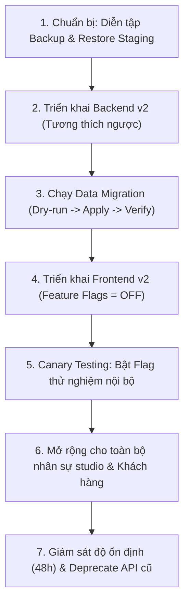

# LONG WEDDING v2.0 — QUY TRÌNH PHÁT HÀNH VÀ VẬN HÀNH (RELEASE RUNBOOK)

**Mã tài liệu:** `docs/v2/05-release-runbook.md`  
**Phiên bản:** 1.0 | **Ngày lập:** 03/11/2026 | **Tác giả:** Antigravity  
**Trạng thái:** Sổ tay hướng dẫn phát hành chuẩn (Production Ready Runbook)

---

## 1. NGUYÊN TẮC PHÁT HÀNH HAI REPOSITORY

Để đảm bảo hệ thống studio LONG WEDDING đang hoạt động hàng ngày không bị gián đoạn dù chỉ 1 phút, quy trình phát hành bắt buộc phải tuân thủ nghiêm ngặt thứ tự sau:



---

## 2. QUẢN LÝ CỜ TÍNH NĂNG (FEATURE FLAGS)

Tất cả các tính năng nghiệp vụ mới đều được bảo vệ bởi Feature Flags. Mặc định khi triển khai, cờ luôn ở trạng thái `false` (tắt).

### 2.1. Danh mục Feature Flags
| Tên cờ (Flag Key) | Mặc định | Chức năng kiểm soát | Phương án Rollback khi có lỗi |
|---|---|---|---|
| `V2_PACKAGE_EDITOR` | `false` | Giao diện tạo/sửa gói dịch vụ đa khổ in v2 | Tắt cờ, quay về giao diện bảng giá v1, DB additive không đổi |
| `V2_CONTRACT_WORKFLOW`| `false` | State Machine chuyển giai đoạn & tự động hóa task | Tắt cờ, hợp đồng hiển thị theo dropdown giai đoạn v1 |
| `V2_SCHEDULING` | `false` | Giao diện kiểm tra availability & khóa trùng lịch | Tắt cờ, quay về màn hình xem lịch v1, backend giữ an toàn |
| `V2_PORTAL_REVIEW` | `false` | Cổng khách hàng v2 (token-based + retouch normalized) | Tắt cờ, chuyển về cổng v1 với lớp bảo vệ token tối thiểu |
| `V2_PRINT_DELIVERY` | `false` | Phân hệ theo dõi đơn in ấn và phiếu bàn giao QC | Tắt cờ, nhân viên theo dõi in ấn qua ghi chú hợp đồng |
| `V2_FINANCE_DASHBOARD`| `false` | Báo cáo doanh thu & đối soát từ sổ cái Ledger | Tắt cờ, xem báo cáo doanh thu theo cách tính v1 |

### 2.2. Điều cấm kỵ tuyệt đối đối với Feature Flags
> [!CAUTION]
> **Tuyệt đối không tạo các cờ tính năng làm suy yếu bảo mật**, ví dụ: `DISABLE_WEBHOOK_AUTH`, `SKIP_RBAC`, `ALLOW_PUBLIC_ALBUM`. Rollback khi có sự cố không bao giờ đồng nghĩa với việc mở lại các lỗ hổng bảo mật P0.

---

## 3. QUY TRÌNH SAO LƯU VÀ PHỤC HỒI DỮ LIỆU (BACKUP & RESTORE)

### 3.1. Sao lưu trước khi triển khai (Pre-deployment Backup)
Trước khi chạy bất kỳ script migration nào trên cơ sở dữ liệu:
```bash
# 1. Tạo thư mục chứa backup theo ngày giờ
TIMESTAMP=$(date +"%Y%m%d_%H%M%S")
BACKUP_DIR="./backups/mongodb_pre_v2_${TIMESTAMP}"
mkdir -p "$BACKUP_DIR"

# 2. Thực hiện dump toàn bộ database (bảo vệ an toàn thông tin nhạy cảm)
mongodump --uri="$DATABASE_URL" --out="$BACKUP_DIR" --gzip

# 3. Ghi nhận số lượng bản ghi của các collection trọng yếu
node ./scripts/check_db_counts.js > "${BACKUP_DIR}/baseline_counts.json"
```

### 3.2. Diễn tập phục hồi trên môi trường Staging (Restore Rehearsal)
1. Khôi phục bản dump lên database Staging (hoặc database cục bộ thử nghiệm).
2. Chạy migration thử nghiệm ở chế độ `--apply`.
3. Kiểm tra đối soát số lượng và tính toàn vẹn dữ liệu.
4. Chỉ khi Staging hoàn toàn xanh và không có sai lệch mới tiến hành trên Production.

---

## 4. CHỈ SỐ GIÁM SÁT & CẢNH BÁO THỜI GIAN THỰC (MONITORING & METRICS)

Trong vòng 48 giờ sau khi phát hành, đội ngũ kỹ thuật phải theo dõi các chỉ số quan trọng sau:

| Tên chỉ số (Metric) | Ngưỡng bình thường | Ngưỡng báo động (Alert) | Hành động xử lý |
|---|---|---|---|
| `sepay_webhook_rejected` | < 1 req/ngày | > 5 req/giờ | Kiểm tra lại Secret key SePay hoặc cấu hình phía SePay |
| `payment_duplicate_attempts` | 0 - 2 req/ngày | > 10 req/giờ | Kiểm tra webhook retry hoặc tấn công replay |
| `contract_balance_mismatch` | **0** | **> 0** | DỪNG TÍNH NĂNG TÀI CHÍNH NGAY LẬP TỨC để đối soát |
| `portal_unauthorized_attempts`| < 5 req/ngày | > 20 req/giờ | Kiểm tra quét mã hợp đồng (IDOR scanner), chặn IP |
| `ssrf_blocked_attempts` | **0** | **> 0** | Phát hiện có đối tượng gửi URL nội bộ vào API tải ảnh |
| `socket_auth_failures` | < 2 req/ngày | > 10 req/giờ | Kiểm tra token hết hạn trên client Socket.IO |

---

## 5. KỊCH BẢN ỨNG PHÓ KHẨN CẤP VÀ ROLLBACK (EMERGENCY ROLLBACK)

### 5.1. Khi phát hiện lỗi giao diện Frontend
1. Tắt Feature Flag tương ứng trong cấu hình hoặc Admin Console.
2. Nếu lỗi nghiêm trọng ở khung vỏ giao diện, triển khai lại bản build commit trước đó (`dev1.0` @ `61ef333`).
3. Thời gian hoàn thành rollback FE: **dưới 5 phút**.

### 5.2. Khi phát hiện lỗi logic Backend
1. Giữ nguyên cấu trúc database additive (không xóa trường mới).
2. Kích hoạt lại fallback sang route adapter cũ.
3. Nếu cần thiết, rollback backend service về commit `dev` @ `125cee9`.
4. Vì database áp dụng chiến lược Non-destructive, dữ liệu v1 vẫn đọc được từ các trường legacy mà không cần restore DB.

### 5.3. Khi phát hiện sai lệch số dư tài chính
1. Khóa tạm thời endpoint thanh toán tự động SePay (chuyển sang chế độ hàng đợi đối soát thủ công).
2. Chạy script đối chiếu:
   ```bash
   node ./scripts/verify_financial_ledger.js --contract=all
   ```
3. Khôi phục số dư theo nhật ký giao dịch thực tế của ngân hàng.
